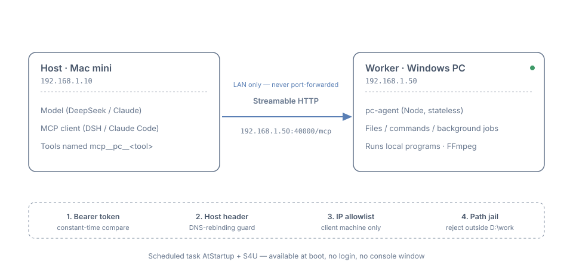

# mcp-lan-agent

**English** ｜ [简体中文](README.zh-CN.md)

Run a **Windows (or Linux/macOS) machine as a LAN MCP agent** — let an AI host (DeepSeek Harness, Claude Code, Claude Desktop) read and write files, run commands, and start long background jobs on a second machine.



> **These are deployment notes plus a reference implementation, not a product.** We publish it because "make an MCP server auto-start on Windows *and* keep Chinese output readable" is barely documented anywhere, and it cost us half a day. The code works; it is not maintained and accepts no feature requests.

---

## Why

Most MCP servers use stdio and run on the host itself. When you have a spare machine that is faster, or that has a specific toolchain installed, making it an HTTP server is more sensible:

- push renders, transcodes and batch jobs to it; the host stays light
- one machine can serve several hosts
- if it reboots, sleeps, or shuts down, the host only loses a group of tools — nothing crashes

The price: **you are handing the model a shell on that machine.** Read [Security](#security) first.

---

## Quick start

**1. Install Node ≥ 20 on the worker**

```powershell
winget install OpenJS.NodeJS.LTS
```

Dependencies are pure JavaScript — `npm install` needs no Python, no Visual Studio Build Tools, no native compilation. You can skip the "Tools for Native Modules" checkbox in the installer.

**2. Deploy**

```powershell
cd D:\pc-agent
npm install
```

**3. Configure**

```powershell
$b = New-Object byte[] 32
([Security.Cryptography.RandomNumberGenerator]::Create()).GetBytes($b)
$t = [Convert]::ToBase64String($b)

$env_text = @"
PC_AGENT_HOST=0.0.0.0
PC_AGENT_PORT=40000
PC_AGENT_TOKEN=$t
PC_AGENT_ROOTS=D:\work
PC_AGENT_ALLOWED_HOSTS=192.168.1.50,localhost,127.0.0.1,[::1],$env:COMPUTERNAME
PC_AGENT_ALLOWED_IPS=192.168.1.10
"@
[IO.File]::WriteAllText("$PWD\.env", $env_text, (New-Object Text.UTF8Encoding($false)))
```

Two details that matter:

- `::Create().GetBytes($b)`, **not** the static `RandomNumberGenerator::GetBytes(32)` — the static overload only exists in .NET Core, and Windows PowerShell 5.1 is .NET Framework. It throws *"does not contain a method named GetBytes"*.
- `[IO.File]::WriteAllText` with `UTF8Encoding($false)` — `Set-Content -Encoding utf8` writes a BOM on PS 5.1, and the BOM turns the first `.env` key into `\uFEFFPC_AGENT_HOST`, which the server cannot read.

**4. Start and verify**

```powershell
.\start-pc-agent.bat
curl.exe http://127.0.0.1:40000/health
```

From the host machine:

```bash
node smoke-test.mjs http://192.168.1.50:40000/mcp "$PC_AGENT_TOKEN"
```

The smoke test asks the server for `system_info` first, then picks `cmd` or `bash` commands accordingly — so you can validate a Windows box from a Mac.

**5. Auto-start without anyone logging in**

```powershell
powershell -ExecutionPolicy Bypass -File .\install-autostart.ps1 -SkipFirewall -AtStartup
```

Then confirm it survives a logoff: sign out to the login screen and probe `/health` from the host.

---

## Tools

| Tool | Purpose |
|---|---|
| `system_info` | Platform, CPU, memory, Node version, allowed roots, running job count |
| `list_dir` | List a directory, optionally recursive |
| `read_file` | Text with line numbers; binary via `encoding="base64"` + byte offsets |
| `write_file` | Write or append, creating parent directories |
| `run_command` | Run and wait; returns exit code, stdout/stderr, duration; kills the process tree on timeout |
| `spawn_job` | Start a background job, log to file, return a `jobId` immediately |
| `job_status` | List jobs, or read one job's status and log tail |
| `kill_job` | Kill a job and its children |

**Use `spawn_job` for anything slow.** A render or FFmpeg encode can run for tens of minutes; a blocking `run_command` will hit the client's tool timeout (60 s by default) and stall the conversation. Poll `job_status` instead — the log tail (`frame 120/300`) is enough to judge progress.

---

## Client setup

**DeepSeek Harness**

```yaml
- id: mcp-pc-agent
  name: '@deepseek-ai/dsh-mcp-client'
  config:
    serverName: pc
    transport: streamable-http
    url: http://192.168.1.50:40000/mcp
    headers:
      Authorization: 'Bearer <token>'
    toolCallTimeoutMs: 600000
    failOnStartupError: false
    reconnect: { enabled: true, maxAttempts: 100000 }
```

Tools appear as `mcp__pc__<tool>`.

**Claude Code**

```bash
claude mcp add --transport http pc-agent http://192.168.1.50:40000/mcp \
  --header "Authorization: Bearer <token>"
```

**Claude Desktop** only accepts stdio launchers; bridge it:

```json
{
  "mcpServers": {
    "pc-agent": {
      "command": "npx",
      "args": ["-y", "mcp-remote", "http://192.168.1.50:40000/mcp",
               "--header", "Authorization:${PC_AGENT_AUTH}"],
      "env": { "PC_AGENT_AUTH": "Bearer <token>" }
    }
  }
}
```

---

## The seven Windows traps

This section is the main reason this document exists. Each one was hit for real.

**1 — Chinese in `.ps1` renders as garbage.**
Windows PowerShell 5.1 decodes BOM-less UTF-8 as ANSI/GBK. Save scripts containing non-ASCII as **UTF-8 with BOM**.

**2 — A `.bat` prints `'delims' is not recognized as an internal or external command`.**
`cmd.exe` parses batch files with the OEM code page (936/GBK on zh-CN). UTF-8 Chinese bytes get re-split as GBK and corrupt whole lines, including `rem` and `for /f`. Keep batch files **pure ASCII with CRLF line endings**.

**3 — Command output turns into `����`.**
`cmd.exe` emits GBK; the server decodes UTF-8. This build prefixes `chcp 65001 >nul &` to every `cmd` invocation and falls back to `TextDecoder('gbk')` when UTF-8 yields replacement characters. This matters more than it looks: Python and FFmpeg errors on Windows are largely Chinese.

**4 — Unreachable at the login screen.**
An `-AtLogOn` scheduled task only starts when someone logs in. `ping` works and `445` is open, but `40000` times out. Use `-AtStartup` with an S4U principal — runs at boot, needs no password, needs nobody logged in.

**5 — The task dies with `0xC000013A`.**
That is `STATUS_CONTROL_C_EXIT`. In `AtLogOn` mode the process lives in your interactive session with a visible console window; closing that window sends `CTRL_CLOSE_EVENT` to the whole console group. Same fix as #4: S4U runs in Session 0 with no console, so nobody can close it.

**6 — `npm install` fails with `EACCES`.**
Ignore npm's "file in use / antivirus / run as administrator" hint — that is its generic text for every `EACCES`. Read the stack: it fails inside `FetchError`, i.e. while *connecting*, before touching disk. On Windows this is a security suite (TinyWall, 360, Huorong, EDR) blocking `node.exe` outbound. Whitelist `node.exe`.
*Diagnostic shortcut:* `curl.exe -I https://registry.npmjs.org/` succeeds but `node -e "fetch(...)"` fails → per-process blocking.

**7 — The client goes permanently `disconnected`.**
MCP clients share one reconnect budget per outage (`reconnect.maxAttempts`). At the default 30 attempts with 0.5 s→30 s backoff it is exhausted in ~12 minutes, after which reconnection stops until the config is reloaded. For a machine that shuts down and sleeps, set `maxAttempts` very high.

Two more diagnostic habits:

- **Timeout ≠ refusal.** `Connection timed out` means packets are dropped (firewall); `Connection refused` means nothing is listening. Opposite directions.
- **A client's tool set is a per-session snapshot.** After installing or reloading an MCP dependency, the current session will not see the new tools — start a new session.

---

## Security

**This server is a root shell on that machine, wrapped in HTTP.** Every design decision follows from that.

| Layer | Mechanism | Purpose |
|---|---|---|
| Network | LAN only | Never expose it publicly, never port-forward |
| Source | `PC_AGENT_ALLOWED_IPS` | Only the client machine may connect |
| Request | Host header validation | DNS-rebinding protection; all local IPs merged in at startup |
| Auth | Bearer token (32 random bytes) | Constant-time compare; refuses to bind a non-loopback address without one |
| Files | `PC_AGENT_ROOTS` jail | `path.relative` check; out-of-root access is rejected |

What it does **not** protect against:

- **Symlinks / junctions.** The jail is lexical; it does not resolve link targets. For real isolation use a dedicated user plus NTFS ACLs.
- **`run_command` itself.** It exists to execute arbitrary commands. The jail constrains the file tools, not the shell.
- **Token leakage.** Static token, no expiry, no rate limit, no lockout. Leak = permanent shell.

**If you need remote access, do not forward the port.** Use a VPN (WireGuard / Tailscale): no open ports, encrypted transport, only your devices can reach it, and the network layer replaces `ALLOWED_IPS`. Cloudflare Tunnel + Access is a reasonable alternative.

---

## Design notes

**Why stateless?** A fresh transport per request (`sessionIdGenerator: undefined`). You give up long-lived subscriptions (`subscriptions/listen`); you gain automatic recovery when the worker reboots, crashes, or the network blips — no reconnect handshake involved. For a machine that shuts down, that trade is worth it.

**Why not WebSocket?** MCP defines stdio and Streamable HTTP only. There is no WebSocket transport; forcing one merely breaks clients.

**Why two execution tools?** `run_command` covers seconds to minutes. `spawn_job` redirects output to a file and returns immediately. Handing the model one "blocking call with a very long timeout" instead would stall the whole conversation.

**Why does the server police the path jail itself?** `PC_AGENT_ROOTS` expresses the deployer's intent. It should not depend on the client behaving.

---

## Licence

MIT — see [LICENSE](LICENSE).
