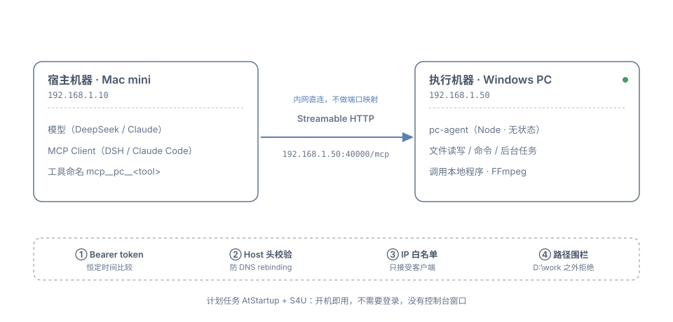

# mcp-lan-agent

[English](README.md) ｜ **简体中文**

把一台 Windows（或 Linux/macOS）机器变成局域网里的 **MCP Agent** —— 让 AI 宿主（DeepSeek Harness、Claude Code、Claude Desktop 等）能在那台机器上读写文件、执行命令、跑几分钟以上的渲染任务。



> **这是一份踩坑笔记 + 一个参考实现，不是一个产品。** 我们把它发布出来，是因为"在 Windows 上把 MCP 服务跑成开机自启、且中文不乱码"这件事的资料很少，而我们为此花了半天。代码给到能跑的程度，但不承诺维护，也不接 feature request。

---

## 为什么要有它

大多数 MCP server 是 stdio 模式、跑在宿主本机。当你有一台**闲置但性能更好、或者装着特定工具链**的机器时，把它变成 HTTP 服务端更合理：

- 渲染、转码、批处理这类重活扔过去，宿主保持轻量
- 一台机器可以服务多个宿主
- 那台机器关机、重启、睡眠，宿主这边只少一组工具，不会崩

代价是：**你等于把一台机器的 shell 交给了模型。** 请先读完[安全模型](#安全模型)。

---

## 快速开始

### 1. 执行机器：装 Node

```powershell
winget install OpenJS.NodeJS.LTS
```

要求 **Node ≥ 20**。装完重开终端，`node -v` 确认。

> 本项目依赖全是纯 JavaScript，`npm install` **不需要** Python、Visual Studio Build Tools 或任何原生编译。Node 安装器最后那个「Tools for Native Modules」选项可以跳过。

### 2. 部署

把仓库拷到执行机器（例如 `D:\pc-agent`），**不要拷 `node_modules`**：

```powershell
cd D:\pc-agent
npm install
```

### 3. 配置

```powershell
$b = New-Object byte[] 32
([Security.Cryptography.RandomNumberGenerator]::Create()).GetBytes($b)
$t = [Convert]::ToBase64String($b)
```

> 注意用 `::Create()` 实例写法。`RandomNumberGenerator::GetBytes(32)` 这个**静态重载只存在于 .NET Core**，Windows 自带的 PowerShell 5.1 会报「不包含名为 GetBytes 的方法」。

```powershell
$env_text = @"
PC_AGENT_HOST=0.0.0.0
PC_AGENT_PORT=40000
PC_AGENT_TOKEN=$t
PC_AGENT_ROOTS=D:\work
PC_AGENT_ALLOWED_HOSTS=192.168.1.50,localhost,127.0.0.1,[::1],$env:COMPUTERNAME
PC_AGENT_ALLOWED_IPS=192.168.1.10
"@
[IO.File]::WriteAllText("$PWD\.env", $env_text, (New-Object Text.UTF8Encoding($false)))
New-Item -ItemType Directory -Force -Path D:\work | Out-Null
```

> 必须用 `[IO.File]::WriteAllText` 配 `UTF8Encoding($false)`。`Set-Content -Encoding utf8` 在 PS 5.1 下会写 BOM，而 BOM 会让 `.env` 第一行的键名变成 `\uFEFFPC_AGENT_HOST`，服务读不到。

### 4. 启动并验证

```powershell
.\start-pc-agent.bat
curl.exe http://127.0.0.1:40000/health
```

另开一台机器（宿主侧）：

```bash
PC_AGENT_TOKEN='<token>' node smoke-test.mjs http://192.168.1.50:40000/mcp "$PC_AGENT_TOKEN"
```

`smoke-test.mjs` 会先问服务端 `system_info` 拿平台，再决定发 `cmd` 还是 `bash` 命令——所以可以在一台 Mac 上验证一台 Windows 机器。

### 5. 开机自启（不依赖登录）

```powershell
powershell -ExecutionPolicy Bypass -File .\install-autostart.ps1 -SkipFirewall -AtStartup
```

- `-AtStartup`：开机 20 秒后自动启动，**不需要任何人登录**（见[坑 4](#坑-4停在登录界面就连不上)）
- `-SkipFirewall`：如果你已有第三方防火墙（TinyWall、火绒等）统一管理，不要再塞 Windows 防火墙规则，避免两处打架
- S4U 权限被拒时加 `-AsSystem`

**验证真的不依赖登录**：注销到登录界面，从宿主机器探 `/health`。

---

## 工具

| 工具 | 用途 |
|---|---|
| `system_info` | 平台、CPU、内存、Node 版本、允许根目录、运行中的任务数 |
| `list_dir` | 列目录，可递归，带大小/修改时间 |
| `read_file` | 文本带行号读；二进制用 `encoding="base64"` + 字节偏移分段 |
| `write_file` | 写入/追加，自动建父目录 |
| `run_command` | 前台执行，返回退出码 + stdout/stderr + 耗时；超时杀整个进程树 |
| `spawn_job` | 后台起任务，输出写日志文件，立刻返回 `jobId` |
| `job_status` | 列任务 / 查单个任务的状态与日志尾部 |
| `kill_job` | 杀任务及其子进程树 |

### 为什么长任务要用 `spawn_job`

渲染、FFmpeg 合成动辄十几分钟。用 `run_command` 硬等会让单次工具调用超时（多数客户端默认 60 秒），模型也会卡住。

```text
spawn_job  { command: "ffmpeg -y -framerate 24 -i frames\\%04d.png -c:v libx264 out.mp4" }
→ { jobId: "2b334d3c", logFile: "..." }

job_status { jobId: "2b334d3c", tailBytes: 20000 }
→ { state: "running" | "exited", exitCode: 0, log: "frame 120/300 ..." }
```

日志尾部足以让模型判断进度，而不必阻塞。

---

## 客户端接入

### DeepSeek Harness

```yaml
- id: mcp-pc-agent
  name: '@deepseek-ai/dsh-mcp-client'
  config:
    serverName: pc
    transport: streamable-http
    url: http://192.168.1.50:40000/mcp
    headers:
      Authorization: 'Bearer <token>'
    toolCallTimeoutMs: 600000
    failOnStartupError: false
    reconnect:
      enabled: true
      maxAttempts: 100000     # 见坑 7
```

工具会以 `mcp__pc__<tool>` 出现。

### Claude Code

```bash
claude mcp add --transport http pc-agent http://192.168.1.50:40000/mcp \
  --header "Authorization: Bearer <token>"
```

### Claude Desktop

Desktop 的 `claude_desktop_config.json` 只吃 stdio 启动器，远程 HTTP 需要桥：

```json
{
  "mcpServers": {
    "pc-agent": {
      "command": "npx",
      "args": ["-y", "mcp-remote", "http://192.168.1.50:40000/mcp",
               "--header", "Authorization:${PC_AGENT_AUTH}"],
      "env": { "PC_AGENT_AUTH": "Bearer <token>" }
    }
  }
}
```

---

## Windows 上的七个坑

这一节是本文档存在的主要理由。每一条都实际踩过。

### 坑 1：`.ps1` 脚本里的中文全是乱码

**症状**：`Write-Host "已注册计划任务"` 输出成乱码。

**根因**：Windows PowerShell 5.1（.NET Framework）读取**无 BOM** 的 UTF-8 脚本时按 ANSI/GBK 解码。

**修法**：含非 ASCII 字符的 `.ps1` 一律存成 **UTF-8 with BOM**。PowerShell 7 能读无 BOM，5.1 不能。

---

### 坑 2：`.bat` 满屏「不是内部或外部命令」

**症状**：

```
'…rem' 不是内部或外部命令
'null' 不是内部或外部命令
'delims' 不是内部或外部命令
'de' 不是内部或外部命令
```

**根因**：`cmd.exe` 用 OEM 代码页（中文系统 936/GBK）解析 `.bat`。UTF-8 的中文字节被按 GBK 重新拆字，把 `rem` / `for /f` 这些行整个污染了。次要原因：LF-only 行尾在 `if (...)` 块和 `for /f` 上也有已知解析问题。

**修法**：`.bat` **纯 ASCII + CRLF**。日志文案用英文，别用中文。

---

### 坑 3：命令输出的中文变成 `����`

**症状**：

```
stderr: "'uname' �����ڲ����ⲿ���Ҳ���ǿ����еij���"
```

**根因**：`cmd.exe` 输出 GBK，服务端按 UTF-8 解码。

**修法**（本项目已内置两条）：

1. `cmd` 命令自动前置 `chcp 65001 >nul &`，让 cmd 自身的提示走 UTF-8
2. 解码时先试 UTF-8；替换字符（`U+FFFD`）超过 0.5% 就回退 `TextDecoder('gbk')`

这个坑比看起来重要：Windows 上 Python、FFmpeg 的报错大量是中文，模型看到一屏 `�` 就等于瞎了。

---

### 坑 4：停在登录界面就连不上

**症状**：重启后不登录桌面，`ping` 通、`445` 通，但 `40000` 超时。

**根因**：计划任务用的 `-AtLogOn` 触发器。它只在**有登录会话**时启动任务。

**修法**：改用 `-AtStartup`（本项目 `install-autostart.ps1` 已支持）：

```powershell
$trig = New-ScheduledTaskTrigger -AtStartup; $trig.Delay = 'PT20S'
$prin = New-ScheduledTaskPrincipal -UserId "$env:USERDOMAIN\$env:USERNAME" -LogonType S4U -RunLevel Highest
Set-ScheduledTask -TaskName PcAgentMcp -Trigger $trig -Principal $prin
```

S4U = Service-for-User，用你的账户身份运行但**不需要登录，也不需要存密码**。

---

### 坑 5：任务结果 `0xC000013A`，服务莫名死掉

**症状**：`Get-ScheduledTaskInfo` 显示 `LastTaskResult = 3221225786`（`0xC000013A`），进程消失。

**根因**：`0xC000013A` = `STATUS_CONTROL_C_EXIT`。`AtLogOn` 模式下进程跑在你的交互会话里、带一个可见的控制台窗口；**关掉那个窗口**会让 Windows 给整个控制台组发 `CTRL_CLOSE_EVENT`，服务跟着死。

**修法**：同坑 4。S4U/SYSTEM 跑在 **Session 0**，没有控制台，也就没人能误关。

---

### 坑 6：`npm install` 报 `EACCES`

**症状**：

```
npm error code EACCES
npm error FetchError: request to https://registry.npmjs.org/... failed
npm error The operation was rejected by your operating system.
npm error It's possible that the file was already in use (by a text editor or antivirus)
```

**根因**：先把 npm 那段「文件被占用 / 杀毒软件 / 用管理员运行」的提示忘掉——它是所有 `EACCES` 的通用套话。看堆栈：失败点在 `FetchError`，是**建立连接时**被操作系统拒绝，还没碰磁盘。Windows 上 Node 拿 `WSAEACCES` 通常是安全软件（TinyWall、360、火绒、企业 EDR）按进程拦截出站。

**修法**：把 `node.exe` 加进安全软件的出站白名单。

**诊断捷径**：`curl.exe -I https://registry.npmjs.org/` 能通、但 `node -e "fetch('https://registry.npmjs.org/')"` 报 `EACCES` → 就是按进程拦截（curl 和 node 是两个二进制）。

---

### 坑 7：客户端突然永久 `disconnected`

**症状**：执行机器恢复后，MCP 客户端仍报 `server is disconnected`，怎么等都不重连。

**根因**：MCP 客户端（如 `@deepseek-ai/dsh-mcp-client`）的 `reconnect.maxAttempts` 是**每次故障共享一个预算**。默认 30 次、退避 0.5s→30s，大约 12 分钟耗尽；之后**停止重连**，必须重载配置或重启宿主才恢复。

**修法**：对"会关机、会睡眠"的机器，把 `maxAttempts` 调到很大（如 `100000`）。恢复方式：重载该 bundle/条目（DSH 里关掉再打开）。

---

### 附：两个诊断经验

- **超时 ≠ 拒绝。** `Connection timed out` = 包被静默丢弃（防火墙）；`Connection refused` = 没进程监听。方向完全不同，别混。
- **客户端工具集是会话级快照。** 新装或重载 MCP 依赖后，**当前会话看不到新工具**，要新开会话。

---

## 安全模型

**这个服务等于那台机器的 root shell，只是包了一层 HTTP。** 所有设计都以此为前提。

| 层 | 机制 | 作用 |
|---|---|---|
| 网络 | 只在内网 | 不暴露到公网（**绝不做端口映射**） |
| 来源 | `PC_AGENT_ALLOWED_IPS` | 只接受指定客户端 IP |
| 请求 | Host 头校验 | 防 DNS rebinding；启动时自动并入本机所有 IP |
| 认证 | Bearer token（32 字节随机） | 恒定时间比较；无 token 时拒绝绑定非回环地址 |
| 文件 | `PC_AGENT_ROOTS` 路径围栏 | `path.relative` 判断，越界直接拒绝 |

### 它挡不住的

- **符号链接 / junction**：路径围栏是字符串层的，不解析链接目标。真有隔离需求就用独立用户 + NTFS ACL。
- **`run_command` 本身**：它就是设计来执行任意命令的。路径围栏只约束"文件工具"，不约束 shell。
- **token 泄漏**：静态 token，无过期、无速率限制、无锁定。泄漏 = 永久 shell。

### 需要远程访问时

**不要做端口映射。** 用 VPN（WireGuard / Tailscale）——不开任何端口、端到端加密、只有你的设备能连，网络层直接替代 `ALLOWED_IPS` 这一层。Cloudflare Tunnel + Access 是另一个可选项。

---

## 成本模型：活在哪干，钱花在哪

### 硬件

| 资源 | 宿主 | 执行端 |
|---|---|---|
| CPU / GPU | ≈ 0 | 子进程的全部 |
| 内存 | 几 MB（传输） | 服务空闲约 90 MB + 子进程 |
| 磁盘 | 会话日志 | 全部文件 I/O |
| 网络 | 每请求几 KB | 同上 |

渲染、转码、编译、批量转换——所有重活都在执行端。宿主只转发 JSON-RPC：每次调用几毫秒 CPU、几 MB 内存，后台任务跑着的时候宿主什么都不做。

这正是设计意图：**执行端是唯一的瓶颈。** 升级宿主不解决任何问题——除非宿主同时还在跑模型。

> 唯一的例外：把模型放到宿主本地跑（Ollama / MLX），瓶颈立刻回到宿主——推理通常比你要派出去的那个任务更贵。

### Token（用收费 API 时）

八个工具的 schema **每一轮都要重发**：4,350 字节 ≈ 1,100 tokens。此外，工具返回的每一个字节都会进入宿主上下文。

```
增量 ≈ 1,100 × 轮数 + 回传字节数 / 4
```

**值得派出去的**

- 长时间 CPU 密集任务：渲染、编码、编译、批量转换——日志小、耗时长
- 需要 Windows 专属软件、GPU，或本机没有的工具链
- 生成大文件、且文件留在执行端
- 用 `spawn_job` 起、隔一阵再查的周期性任务

**留在本机更划算的**

- 读大量文件——一百个文件回传，比自己本地读贵得多
- 反复搜索 / grep：在文本本来就在的地方搜
- 改一行 → 跑 → 看结果的紧循环，重复十几次（往返 + schema 税会累加）
- 枚举大的目录树
- 任何需要频繁看中间输出的任务

一句话：**让算力过去，别让数据回来。**

默认上限就是为此设的：`PC_AGENT_MAX_OUTPUT`（200 KB ≈ 5 万 tokens）和 `job_status` 的 `tailBytes`（64 KB）。上下文紧张就把两个都调小。

### 要不要优先用本地模型

那样 token 账单直接消失，代价转移到宿主的算力上。通常值得做——但有一个要诚实说明的前提：**小模型的工具调用可靠性明显低于前沿云端模型。** 一次调错工具再重试的代价，往往超过它省下的那点 token。先测再定。

---

## 设计取舍

**为什么无状态？** 每个请求新建 transport（`sessionIdGenerator: undefined`）。代价是用不了 `subscriptions/listen` 这类长连订阅；收益是那台机器重启、进程崩溃、网络闪断，客户端下一次请求就自动恢复，不需要 reconnect 握手。对一个会关机的 PC，这笔交易划算。

**为什么不用 WebSocket？** MCP 规范只定义 stdio 和 Streamable HTTP。没有 WS 传输，硬套只会让客户端连不上。

**为什么前台/后台两套工具？** `run_command` 适合秒级到分钟级；`spawn_job` 把输出重定向到日志文件、立刻返回。让模型自己选，比给它一个"超时很长"的阻塞调用更好——后者会把整个对话卡住。

**为什么服务端自己做路径围栏？** 因为 `PC_AGENT_ROOTS` 是部署者的意图表达，不该依赖客户端自觉。

---

## 文件清单

| 文件 | 作用 |
|---|---|
| `server.mjs` | 全部逻辑：8 个工具 + HTTP 入口 + 鉴权 + 路径围栏 + 编码处理 |
| `package.json` | 依赖：`@modelcontextprotocol/server` ^2、`@modelcontextprotocol/node` ^2、`zod` ^4 |
| `.env.example` | 配置模板 |
| `start-pc-agent.bat` | 前台启动（**排错用**；已部署实例请用计划任务） |
| `install-autostart.ps1` | 计划任务（`-AtStartup` / `-AsSystem`）+ 防火墙 + `-Uninstall` |
| `smoke-test.mjs` | 端到端自检，按对端平台选命令 |
| `.gitattributes` | 保持 `.bat` / `.ps1` 的原始字节（BOM 与 CRLF 不能丢） |
| `docs/architecture.*.svg` | 架构图（中 / 英），README 顶部引用 |

## 验证状态

服务端在 macOS + Node 24/26 与本仓库目标环境（Windows 11 + Node 26）上跑通完整链路：`tools/list`、文件读写、`run_command`、`spawn_job` → `job_status`、超时杀进程树、401/403 鉴权、路径越界拦截、GBK 解码、S4U 开机自启（登录界面下可从另一台机器访问）。

协议层用 MCP TypeScript SDK **v2**（2026-07-28 规范）。

## 许可

MIT，见 [LICENSE](LICENSE)。
